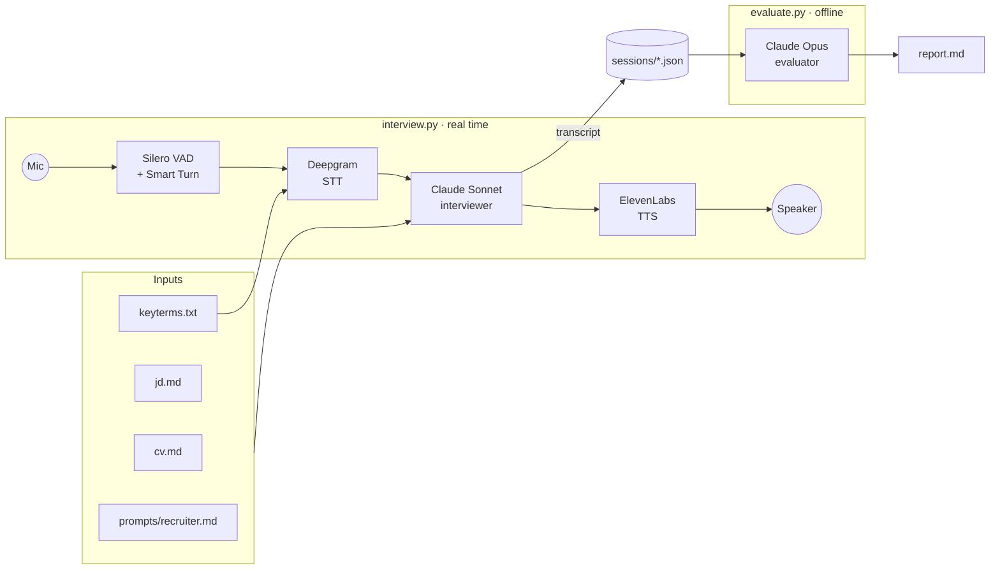

# Interview Coach

**Practice job interviews in English, out loud, with an AI interviewer, and get a detailed report on what you said and how you said it.**

You talk to a voice-based recruiter in real time. It knows your CV and the job you are applying for. It asks follow-up questions when your answers are vague, and it lets you interrupt it. When the call ends, a second model reviews the transcript and writes a report covering:

- **Content**: answer by answer, with a STAR check for behavioral questions and a stronger version of each key answer, built only from facts in your CV.
- **English**: concrete errors with corrections, recurring patterns (tense, articles, false friends from your native language), vocabulary upgrades and an estimated CEFR level for spoken production.
- **Next session**: three specific things to work on.

Built for non-native speakers preparing for interviews in English. It is aimed at senior engineers, where the hard part is telling a complex story clearly under pressure.

> 🎥 **Demo:** 

https://github.com/user-attachments/assets/b74922ac-4138-4da1-a6a1-53f87dad4029

---

## How it works



There are two separate programs, on purpose:

| | `interview.py` | `evaluate.py` |
|---|---|---|
| Goal | Feel like a real call | Give accurate, detailed feedback |
| Constraint | Latency: under ~1 s per turn | Quality: no time pressure |
| Model | Fast (Sonnet) | Strongest (Opus) |

---

## Design decisions

### A cascaded pipeline instead of speech-to-speech
Speech-to-speech models (OpenAI Realtime, Gemini Live) have lower latency, but you have less control over the transcript and you are tied to one LLM. The whole point of this tool is to evaluate **what you said**, so a text transcript of your speech is the core artifact. A cascaded pipeline (STT → LLM → TTS) gives you that transcript, lets you choose the best model for each role, and costs less over 20–30 minute sessions. In an interview, a 600–900 ms response time feels natural, because human interviewers pause too.

### Turn-taking is the hardest part
In interviews, people pause to think. A voice agent tuned for customer support treats a 300 ms silence as "done talking" and cuts the candidate off mid-sentence. The first version did exactly that: answers came out as 3-word fragments, and the interviewer kept jumping in.

The fix is to end a user turn only when **two independent signals agree**:
1. **Smart Turn**, a local model that analyses intonation to decide whether the sentence sounds finished.
2. **A minimum silence** (`USER_SPEECH_TIMEOUT`, 1.5 s by default), so a short thinking pause is never treated as the end of a turn.

### STT artifacts are not the candidate's mistakes
Speech-to-text mishears proper nouns and jargon. "Serializable" becomes "daily server", and "row locks" becomes "draw logs". An evaluator that trusts the transcript blindly would blame the candidate for these. Two mitigations:
- **Keyterms** (`inputs/keyterms.txt`): names and technical terms are passed to Deepgram so it recognises them.
- **Evaluator instructions**: the evaluator prompt says the input is an STT transcript. It tells the model to ignore likely transcription artifacts, to not judge fluency on missing filler words (the streaming API drops them), and to ignore remarks addressed to the tool.

### The interviewer stays in character
All coaching happens after the call. During the call, the interviewer behaves like a real recruiter: one question per turn, follow-ups when an answer is vague, and no corrections. Feedback in the middle of an answer breaks the pressure the exercise is meant to simulate.

---

## Getting started

**Requirements:** Python 3.11+ (tested with 3.13), and on macOS `brew install portaudio` for microphone access.

```bash
git clone https://github.com/martahg/interview-coach.git
cd interview-coach
python -m venv .venv && source .venv/bin/activate
pip install -r requirements.txt
cp .env.example .env    # then fill in your keys in .env
```

Fill in your inputs, in English:
- `inputs/cv.md`: your CV
- `inputs/jd.md`: the job description
- `inputs/keyterms.txt` (optional): names and technical terms from your CV and the job, one per line

To keep your real data out of git:
```bash
git update-index --skip-worktree inputs/cv.md inputs/jd.md inputs/keyterms.txt
```

Run a session:
```bash
python interview.py                          # talk; press Ctrl+C to end
python evaluate.py sessions/<file>.json      # writes sessions/<file>.report.md
```

**Tips**
- **Use headphones.** There is no echo cancellation locally, so without them the interviewer hears itself and interrupts itself.
- **To end the call, press Ctrl+C without saying anything.** Everything you say is transcribed and goes into the report.
- On first run, macOS asks for microphone permission for your terminal.

### API keys

| Service | Used for | Free tier |
|---|---|---|
| [Deepgram](https://console.deepgram.com) | Speech-to-text | Yes, free credit on sign-up |
| [Anthropic](https://console.anthropic.com) | Interviewer and evaluator | No. A few dollars covers many sessions |
| [ElevenLabs](https://elevenlabs.io) | Text-to-speech | Yes. Use a **default** voice, because community voices return `402` on the free plan |

### Configuration (`.env`)

| Variable | Description |
|---|---|
| `DEEPGRAM_API_KEY`, `ANTHROPIC_API_KEY`, `ELEVENLABS_API_KEY` | Service keys |
| `ELEVENLABS_VOICE_ID` | Interviewer voice |
| `INTERVIEWER_MODEL` | Real-time model (optimise for latency) |
| `EVALUATOR_MODEL` | Report model (optimise for quality) |
| `PERSONA` | Which file in `prompts/` to use as the interviewer |
| `USER_SPEECH_TIMEOUT` | Optional. Seconds of silence before your turn ends (default `1.5`) |

---

## Project structure

| Path | Purpose |
|---|---|
| `interview.py` | Builds the real-time voice pipeline and saves the transcript |
| `evaluate.py` | Turns a transcript into a feedback report |
| `prompts/recruiter.md` | Interviewer persona, call structure and rules (`{cv}` and `{jd}` are filled in at runtime) |
| `prompts/evaluator.md` | Report rubric |
| `inputs/` | Your CV, the job description and optional STT keyterms |
| `sessions/` | Transcripts (`.json`) and reports (`.report.md`), git-ignored |

To add another interviewer, such as a technical one, create `prompts/tech_lead.md` and run with `PERSONA=tech_lead`.

---

## Troubleshooting

| Symptom | Likely cause | Fix |
|---|---|---|
| Cuts you off when you pause to think | Turn ends too early | Raise `USER_SPEECH_TIMEOUT` (try `2`) |
| Slow to respond after you finish | Turn ending is too conservative, or the LLM is slow | Lower `USER_SPEECH_TIMEOUT` (try `1.2`); check per-service latency in the log |
| Names or tech terms transcribed wrongly | STT doesn't know them | Add them to `inputs/keyterms.txt` |
| Deepgram 401 + ElevenLabs 403 + Anthropic "no api_key" | Keys are missing from `.env` (often put in `.env.example` by mistake) | Fill in `.env` |
| ElevenLabs `402` / "completed with no audio" | Community voice on the free plan | Use a default voice |
| Interviewer interrupts itself | Mic picks up the speaker | Use headphones |

Tested with **Pipecat 1.14** and **deepgram-sdk 7.16**. Pipecat moves fast, so if an import breaks after an upgrade, compare with the examples in its repo.

---

## Roadmap

- [ ] **Technical interviewer**: system design and deep dives into the candidate's projects
- [ ] **Automatic keyterms**: extract them from the CV and job description at startup
- [ ] **Memory across sessions**: the next interviewer focuses on the weak points from the last report
- [ ] **End the call on goodbye**: an `end_call` tool, so the interviewer hangs up without Ctrl+C
- [ ] **Company research**: add public information about the company to the interviewer's context
- [ ] **Browser version**: WebRTC transport with echo cancellation
- [ ] **Pronunciation feedback**: audio-level analysis, not just the transcript
- [ ] **Exam mode**: the same core with an examiner persona and rubric for English certifications (C1)

---

## Built with

[Pipecat](https://github.com/pipecat-ai/pipecat) · [Deepgram](https://deepgram.com) · [Anthropic Claude](https://www.anthropic.com) · [ElevenLabs](https://elevenlabs.io) · [Silero VAD](https://github.com/snakers4/silero-vad)

---

## License

Copyright (C) 2026 Marta Hernández Granado

This project is licensed under the [GNU Affero General Public License v3.0](LICENSE).
If you run a modified version of this software as a network service, you must make
its source code available to the users of that service.
